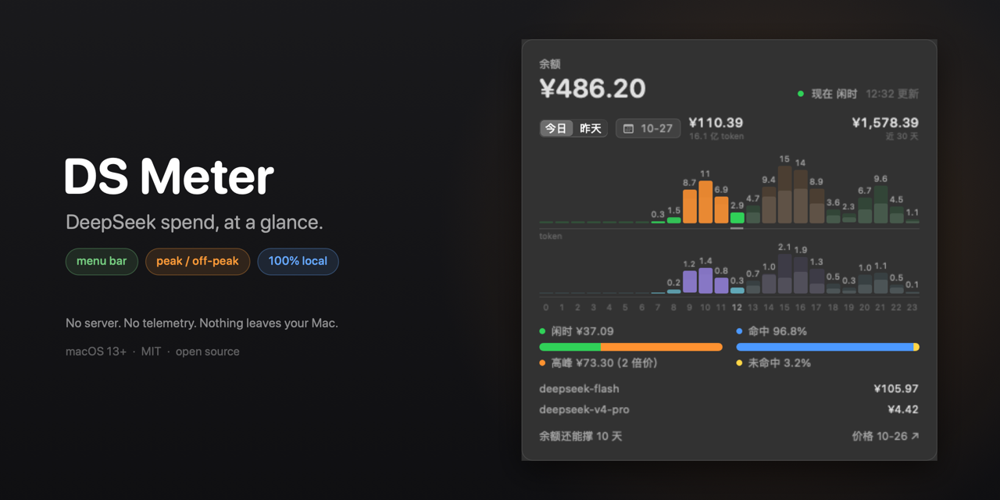
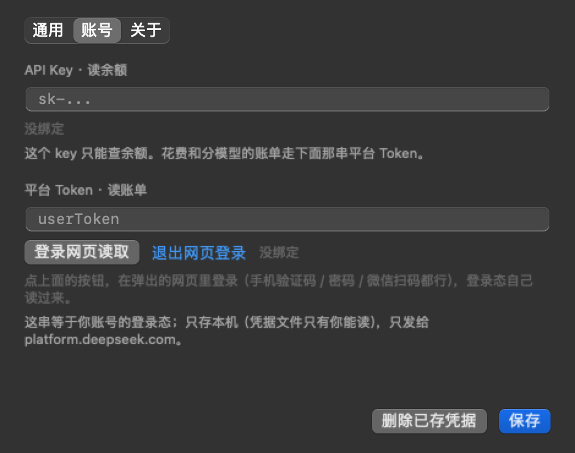

# DS Meter



菜单栏里一格：一颗灯 + 今天花了多少钱。灯绿 = 闲时（半价），灯黄 = 高峰（双倍）。点开是明细。

**完全本地运行**：没有服务器、没有账号体系、没有统计上报；你的 key 和登录态只在这台 Mac 上。

**中文** · [English](#english)

> 非官方工具，跟 DeepSeek 官方没关系。用量读的是平台网页自己在用的账单接口，没有公开文档，随时可能变。

## 30 秒上手（已经有 Xcode 命令行工具）

```bash
git clone <仓库地址> ds-meter && cd ds-meter && ./scripts/build-app.sh
open "/Applications/DS Meter.app"
```

然后：菜单栏那格 → 「登录网页读取」→ 登录 → 出数。

| 1. 菜单栏那一格 | 2. 第一次打开 |
| --- | --- |
|  |  |

| 3. 登录窗口（app 自己的） | 4. 登录后的面板 |
| --- | --- |
|  |  |

日期按钮把最近 30 天铺成一条柱条，点哪天看哪天：


## 安全：全本地，没有服务器

- **没有任何服务器**。这个项目没有后端、没有账号体系、没有统计上报、没有第三方 SDK、没有自动更新通道。
- **只连两个域名**：`api.deepseek.com`（查余额）、`platform.deepseek.com`（读账单）。没有第三个。
- **凭据只存本机**：`~/Library/Application Support/DSMeter/account.json`，目录 `0700`、文件 `0600`，只有你这个用户能读；网页登录态在 `~/Library/WebKit/app.dsmeter.macos`。设置里「删除已存凭据 / 退出网页登录」分别清掉。
- **不读你的内容**：不读对话、不读会话日志、不读别的 app 的数据。账单响应只在内存里（磁盘缓存关掉了），不落盘。
- **可以自己核**：源码两千多行，`--probe` 会把当前所有数字打出来；Little Snitch 之类的工具看它只连那两个域名。
- **诚实的边界**：登录态等于你账号的钥匙，Mac 被攻破就能被读走——跟浏览器里的 cookie 是同一级风险。所以给了「退出网页登录」，也建议不用时点一下。

## 它怎么工作（三句话）

1. **余额**：app 拿你填的 `sk-` key，去问官方余额接口「这个账户还有多少钱」。这是公开接口。
2. **账单**：DeepSeek 没有开放账单 API；网页的用量页靠浏览器里的一串登录凭证取数。app 在自己的窗口里让你登录一次，拿到那串凭证，之后替你去读同一份账单。
3. **所以**：不登录只有余额；登录了才有今天花了多少、每小时、分模型、命中率。凭证只存本机，只发给 `platform.deepseek.com`。

## 装

- macOS 13+，Apple Silicon / Intel 都行
- Xcode 命令行工具：`xcode-select --install`（一次，几个 GB；装过就跳过）

```bash
git clone <仓库地址> ds-meter
cd ds-meter
./scripts/build-app.sh     # 编 + 装进 /Applications，约 10 秒
```

只发源码，仓库和 Release 里都没有 `.app` / `.dmg`：自己编，就没有「信不信作者的二进制」这回事。默认 ad-hoc 签名；有自己的证书就 `SIGN_ID="Apple Development: 你的名字 (XXXXXXXXXX)" ./scripts/build-app.sh`。

第一次运行会在「登录项」里注册开机自启，可以关。卸载：`./scripts/uninstall.sh`。

## 两种用法

**登录（推荐）**：看账单。菜单栏 → 登录网页读取，或者直接在面板上点那颗按钮。

**只填 API Key**：只看余额。右键 → 账号… → 贴 `sk-` 开头的 key：



两个都不填时，第一次启动会自动弹面板，只有两行字和一颗按钮（上图第 2 张）。

## 数据从哪来

| 显示 | 来源 | 精度 |
| --- | --- | --- |
| 余额 | `api.deepseek.com/user/balance`（`sk-`） | 实时，到分 |
| 今天 / 每小时 / 分模型 / 命中率 / 近 30 天 / 还能撑几天 | `platform.deepseek.com/api/v0/usage/by_api_key/{cost,amount}`（登录态） | 跟网页用量页同源，滞后约 5 分钟 |

## 已知限制

- 账单接口一次最多给 30 天，日期条只有 30 天，更早的要上网页看。
- 认不出法定节假日：节假日那天的「高峰」会多算一倍价。
- 只统计登录那个账号的账单；余额是账号级的。
- 平台账单本身滞后约 5 分钟，别拿它对秒。
- 登录态会过期，过期后点一次「登录网页读取」重登。
- 接口不是公开 API：改了路径或加了风控，这工具就取不到数；默认 2 分钟一次，连续失败自动退避（最长 15 分钟一次）。

## 计费规则

高峰：北京时间**工作日** 9–12、14–18，单价双倍；其余时段、周末、节假日全天是闲时价（高峰的一半）。

元 / 百万 tokens（闲时 → 高峰）：

- `deepseek-flash`：命中 0.02 → 0.04、未命中 1 → 2、输出 4 → 8
- `deepseek-v4-pro`：命中 0.15 → 0.30、未命中 4.5 → 9、输出 13.5 → 27

价格页：https://api-docs.deepseek.com/zh-cn/quick_start/pricing

## 开发

```bash
swift build -c release

.build/release/DSMeter --probe                                  # 真数据打一遍数字
.build/release/DSMeter --probe --demo --snapshot /tmp/dsm --status /tmp/dsm   # 假数据出图
.build/release/DSMeter --probe --demo --logged-out --snapshot /tmp/dsm        # 「还没登录」那屏
.build/release/DSMeter --probe --fresh --snapshot /tmp/dsm                    # 「第一次打开」那屏
.build/release/DSMeter --probe --fresh --settings-shot --snapshot /tmp/dsm    # 设置页
.build/release/DSMeter --probe --login-check --snapshot /tmp/dsm              # 登录窗口自检
swift scripts/make-banner.swift                                                # 重新生成 banner
```

## License

MIT，见 `LICENSE`。

---

# English

A menu bar item: a dot + today's spend. Green = off-peak (half price), yellow = peak (double). Click for details.

**Runs entirely locally**: no server, no account system, no telemetry. Your key and sign-in token never leave this Mac.

> Unofficial tool, not affiliated with DeepSeek. Usage numbers come from the same billing endpoint the platform's own web page uses. It is undocumented and may change at any time.

## Quick start

```bash
git clone <repo> ds-meter && cd ds-meter && ./scripts/build-app.sh
open "/Applications/DS Meter.app"
```

Then: menu bar → **Sign in on web** → sign in → done.

| 1. The menu bar item | 2. First launch |
| --- | --- |
|  |  |

| 3. Sign-in window (inside the app) | 4. After signing in |
| --- | --- |
|  |  |

The date button unrolls the last 30 days as a strip; click a day to inspect it:


## Security: all local, no server

- **No backend at all.** No server, no accounts, no telemetry, no third-party SDK, no auto-update channel.
- **Two hosts, period**: `api.deepseek.com` (balance) and `platform.deepseek.com` (billing).
- **Credentials stay on disk, for you only**: `~/Library/Application Support/DSMeter/account.json`, directory `0700`, file `0600`; the web sign-in state lives in `~/Library/WebKit/app.dsmeter.macos`. Both can be wiped from Settings.
- **Your content is never read**: no conversations, no session logs, no other apps' data. Billing responses live in memory only (disk cache is disabled).
- **Verify it yourself**: ~2.6k lines of source, `--probe` prints every number it holds, Little Snitch shows only those two hosts.
- **Honest limit**: the sign-in token is effectively an account key. If your Mac is compromised, it can be read — same risk class as browser cookies. That is why "Sign out of web" exists.

## How it works (in three sentences)

1. **Balance**: the app asks DeepSeek's public balance endpoint with the `sk-` key you provide.
2. **Billing**: DeepSeek has no public billing API. Its usage page reads data using a sign-in token stored in the browser. The app opens its own sign-in window once, takes that token, and reads the same billing numbers for you.
3. **Therefore**: without signing in you only get the balance; with it you get today's spend, hourly bars, per-model costs and cache-hit rate.

## Requirements

- macOS 13 or later, Apple Silicon or Intel.
- Xcode command line tools: `xcode-select --install` (one time, a few GB).

```bash
git clone <repo> ds-meter
cd ds-meter
./scripts/build-app.sh
```

Source only: no `.app` or `.dmg` in the repo or in Releases, so nobody has to trust a binary someone else built. Ad-hoc signing by default; bring your own certificate with `SIGN_ID="Apple Development: Your Name (XXXXXXXXXX)" ./scripts/build-app.sh`.

The first run registers a login item (can be turned off). Uninstall with `./scripts/uninstall.sh`.

## Two ways to use it

**Sign in (recommended)**: full billing view. Menu bar → Sign in on web, or press the button in the panel.

**API key only**: balance only. Right-click → Account… → paste your `sk-` key:


With neither configured, the first launch opens the panel by itself with one explanation and one button.

## Where the numbers come from

| Shown | Source | Precision |
| --- | --- | --- |
| Balance | `api.deepseek.com/user/balance` (`sk-`) | live, to the cent |
| Today / hourly / per-model / cache hit / last 30 days / runway | `platform.deepseek.com/api/v0/usage/by_api_key/{cost,amount}` (sign-in) | same data as the web usage page, ~5 min behind |

## Known limits

- The billing endpoint returns at most 30 days at a time.
- Public holidays are not detected: a holiday treated as a workday overprices the peak segment by 2×.
- Only the signed-in account's billing; balance is account-wide.
- Billing data lags ~5 minutes.
- The sign-in expires; press the button again to refresh it.
- The endpoint is undocumented. Paths or rate limits may change; if so, the app stops reading (2-minute polling with exponential backoff, 15 minutes max).

## Pricing reference

Peak: Beijing time, **workdays** 9–12 and 14–18, double price. Everything else is off-peak (half of peak).

CNY per million tokens (off-peak → peak):

- `deepseek-flash`: hit 0.02 → 0.04, miss 1 → 2, output 4 → 8
- `deepseek-v4-pro`: hit 0.15 → 0.30, miss 4.5 → 9, output 13.5 → 27

Price page: https://api-docs.deepseek.com/zh-cn/quick_start/pricing

## Development

```bash
swift build -c release

.build/release/DSMeter --probe                                               # real data, print numbers
.build/release/DSMeter --probe --demo --snapshot /tmp/dsm --status /tmp/dsm  # demo data, render PNGs
.build/release/DSMeter --probe --demo --logged-out --snapshot /tmp/dsm       # the "not signed in" screen
.build/release/DSMeter --probe --fresh --snapshot /tmp/dsm                   # the "first launch" screen
.build/release/DSMeter --probe --fresh --settings-shot --snapshot /tmp/dsm   # the settings window
.build/release/DSMeter --probe --login-check --snapshot /tmp/dsm             # opens the sign-in window
swift scripts/make-banner.swift                                              # regenerate the banner
```

## License

MIT — see `LICENSE`.
