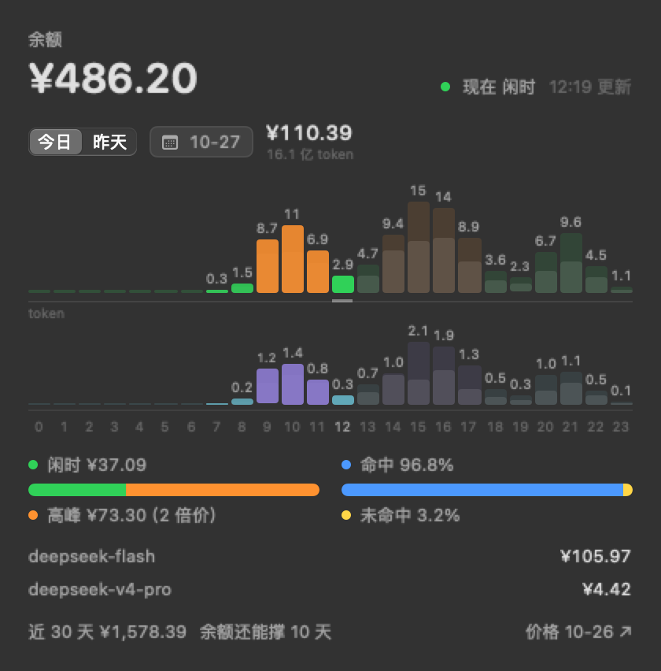
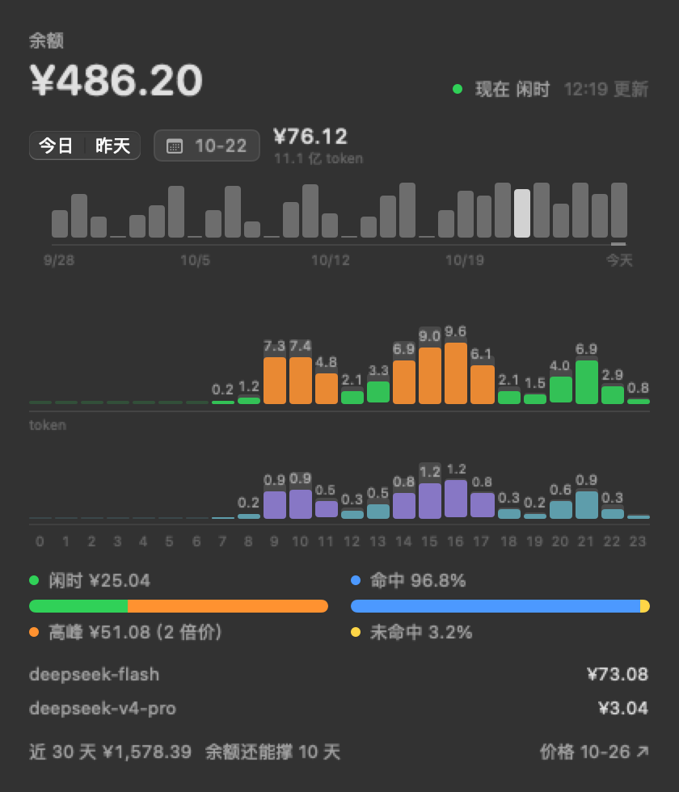
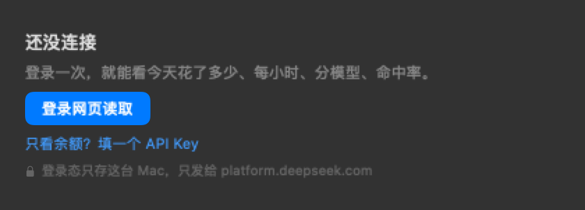
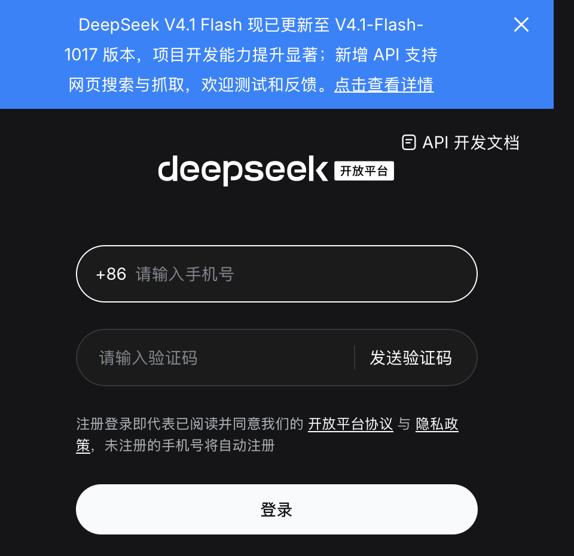
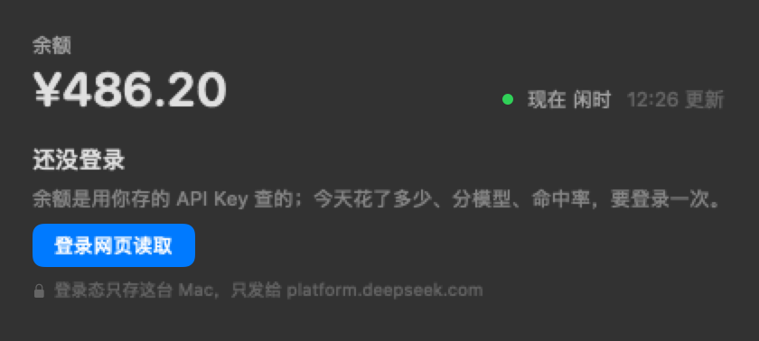

# DS Meter

菜单栏上的一格：一颗灯 + 今天花了多少钱。灯绿 = 闲时（半价），灯黄 = 高峰（双倍价）。点开是明细。



> 非官方工具，跟 DeepSeek 官方没关系。用量读的是平台网页自己在用的那个账单接口，没有公开文档，随时可能变。

## 它显示什么

- 今天花了多少、昨天多少、近 30 天多少
- 每小时：上排是钱（绿闲时 / 橙高峰），下排是 token；两层背后那道灰影是前一天同一小时
- 闲时 / 高峰各花了多少，高峰那段多付了多少（2 倍价；括号说的是单价倍数，不是拿金额再乘 2）
- 缓存命中率，跟昨天同一时刻比
- 分模型的钱和 token
- 余额还剩多少，按最近 30 天平均还能撑几天

日期按钮把最近 30 天铺成一条迷你柱条（9/28 → 今天），点哪天看哪天：



菜单栏那一格长这样（左绿右黄）：


## 需要什么

- macOS 13 或更新，Apple Silicon / Intel 都行
- Xcode 命令行工具：`xcode-select --install`（一次，几个 GB；已经装过就不用）
- 第一次用要在 app 里登录一次 DeepSeek 开放平台（手机验证码 / 密码 / 微信扫码都行）

## 装

```bash
git clone <仓库地址> ds-meter
cd ds-meter
./scripts/build-app.sh
```

- 编完装到 `/Applications/DS Meter.app`，编一次约 10 秒。
- 只发源码，仓库和 Release 里都没有 `.app` / `.dmg`：自己编出来的包带着你这台机器的签名，不往外发。
- 默认 ad-hoc 签名。自己有开发者证书就 `SIGN_ID="Apple Development: 你的名字 (XXXXXXXXXX)" ./scripts/build-app.sh`。
- 第一次运行会在系统设置 → 登录项里注册开机自启，可以关。
- 卸载：`./scripts/uninstall.sh`（应用、自启、凭据、网页登录态、缓存一起清）。

## 第一次运行

1. 打开 DS Meter，菜单栏右边出现一格，先是「—」。第一次启动会自动把面板弹出来（不弹设置表），长这样：



2. 右键那一格 → **设置…** → 账号
3. 「API Key · 读余额」填 `sk-` 开头的 key（platform.deepseek.com → API keys）。它只能查余额。
4. 「平台 Token · 读账单」点 **登录网页读取**，在弹出的窗口里登录：



登录成功后 app 自己把登录态读过来、关掉窗口、开始出数。不用开开发者工具，不用拷 token。

没登录时面板长这样——一句话加一颗按钮，点了直接开登录窗口（右键菜单里也有「登录网页…」）：



只填 `sk-` key 不登录也能用一点：面板里只有余额一行，其余是空的——花费和明细全在账单接口里，那个接口只认登录态。

## 设置

右键那一格：刷新、**开机自动启动**（勾选了就装 LaunchAgent、登录时拉起；再点取消就删掉）、**设置…**（⌘,）、登录网页…、打开用量页 / 价格页、退出。

设置页分三格：

- **通用**：开机自动启动、刷新节奏（省电 5 分钟 / 默认 2 分钟 / 最频繁 30 秒）、语言
- **账号**：`sk-` key（读余额）+ 网页登录（读账单），底部保存 / 删除已存凭据
- **关于**：计费规则与价格页链接、数据说明

界面语言跟着系统走：系统是中文就中文，其他一律英文。想单独给这个 App 定语言，走「系统设置 → 语言与地区 → 应用程序」，重开 App 生效。文案在 `Sources/DSMeter/L10n.swift`，中英两份用 switch 写在一起，漏一条编不过。

## 登录是怎么工作的

- 那个窗口是 app 里的一个浏览器（WKWebView），打开的就是 `platform.deepseek.com` 的登录页。手机号、验证码、密码只在你和 DeepSeek 之间，app 不读你输入的内容。
- 登录后站点把 `userToken` 写进自己的 localStorage；app 读到之后**先拿账单接口验一次**，验得过才存。没登录时站点会写一个 `{"value":null}` 的空壳，验不过，不会被当成 token（这条是踩过的坑）。
- 登录态留在 app 自己的数据目录（`~/Library/WebKit/app.dsmeter.macos`）。所以 token 过期时再点一次「登录网页读取」，通常还是登录状态，读到就走，不用重新输密码。
- 不想留登录态就点「退出网页登录」：网页 cookie / localStorage 和存下来的 token 一起删。

## 数据从哪来

| 显示 | 来源 | 精度 |
| --- | --- | --- |
| 余额 | `GET https://api.deepseek.com/user/balance`（`sk-`） | 实时，到分 |
| 今日 / 每小时 / 分模型 / 命中率 / 近 30 天 / 还能撑几天 | `platform.deepseek.com/api/v0/usage/by_api_key/{cost,amount}`（登录态） | 跟网页用量页同源，滞后约 5 分钟 |

没有「按 token 折价」「按余额差推算」这类二手算法：两个数都来自账单，不会互相打架。

## 隐私

- 只连两个域名：`api.deepseek.com`（余额）、`platform.deepseek.com`（账单）。没有别的服务器、没有统计上报、没有第三方 SDK、没有自动更新。
- 不读对话内容，不读会话日志，不读别的 app 的数据。
- 账单响应只在内存里，关掉了磁盘缓存。
- 存本机两样：`~/Library/Application Support/DSMeter/account.json`（两串凭据，目录 0700、文件 0600）和网页登录目录（上面那个）。两样都能在设置里一键清。
- 想自己核：`--probe` 把当前所有数字打出来；Little Snitch 看它只连那两个域名；源码在 `Sources/`，两千多行。

## 已知限制

- 账单接口一次最多给 30 天，日期条只有 30 天，更早的要上网页看。
- 认不出法定节假日（没有假期表）：节假日那天的「高峰」会被多算一倍价。
- 只统计登录那个账号的账单。
- 平台账单滞后约 5 分钟，别拿它对秒。
- 登录态会过期，过期后重新点一次「登录网页读取」。
- 页脚「价格 10-26」是写死的核对日期，超过 30 天变黄提醒点开价格页；DeepSeek 调价不会自动跟上。
- 接口不是公开 API：DeepSeek 改了路径或加了风控，这工具就取不到数；频繁请求也可能被限流（默认 2 分钟一次）。

## 计费规则

高峰：北京时间**工作日** 9–12、14–18，单价双倍；其余时段、周末、节假日全天是闲时价（高峰的一半）。

元 / 百万 tokens（闲时 → 高峰）：

- `deepseek-flash`：命中 0.02 → 0.04、未命中 1 → 2、输出 4 → 8
- `deepseek-v4-pro`：命中 0.15 → 0.30、未命中 4.5 → 9、输出 13.5 → 27

价格页：https://api-docs.deepseek.com/zh-cn/quick_start/pricing

## 开发

```bash
swift build -c release

# 真数据打一遍数字
.build/release/DSMeter --probe

# 出截图：假数据，不读凭据、不发请求
.build/release/DSMeter --probe --demo --snapshot /tmp/dsm --status /tmp/dsm

# 打开登录窗口自检（只开页面、不登录），存一张图
.build/release/DSMeter --probe --login-check --snapshot /tmp/dsm
```

```
Sources/DSMeter/
  main.swift           入口（--probe 走自检）
  AppDelegate.swift    菜单栏那一格、面板、右键菜单、睡眠停轮询
  Meter.swift          取数、按天缓存、失败退让；loadDemo 是截图用的假数据
  PlatformClient.swift 平台账单接口（不公开，见上）
  Balance.swift        官方余额接口
  MeterPanel.swift     展开的面板
  PickerStrip.swift    面板里那条 30 天的日期条
  LoginWindow.swift    登录窗口（WKWebView 登录一次，读 localStorage 里的 userToken）
  PeakHours.swift      高峰 / 闲时判断、价格页
  Account.swift        凭据文件（0600），不做钥匙串
  SettingsView.swift   账号 / 刷新档位 / 自启 / 数据说明
  L10n.swift           中英文案（跟系统语言；DSM_LANG 可强指）
  LoginItem.swift      开机自启（LaunchAgent）
  Probe.swift          --probe：打数字、出 PNG
```

## License

MIT，见 `LICENSE`。
